# 📋 Perancangan Sistem Informasi Apotek

> **Versi**: 1.0  
> **Tanggal**: 27 Agustus 2026  
> **Status**: Draft

---

## Daftar Isi

1. [Gambaran Umum Sistem](#1-gambaran-umum-sistem)
2. [Arsitektur Sistem](#2-arsitektur-sistem)
3. [Manajemen Pengguna & Hak Akses](#3-manajemen-pengguna--hak-akses)
4. [Modul POS (Point of Sale)](#4-modul-pos-point-of-sale)
5. [Modul Gudang / Warehouse](#5-modul-gudang--warehouse)
6. [Modul Pembelian / Purchasing](#6-modul-pembelian--purchasing)
7. [Modul Retur](#7-modul-retur)
8. [Modul Stok Opname](#8-modul-stok-opname)
9. [Modul Pengelolaan Stok](#9-modul-pengelolaan-stok)
10. [Modul Data Expired](#10-modul-data-expired)
11. [Modul Batch Management](#11-modul-batch-management)
12. [Modul Master Data](#12-modul-master-data)
13. [Modul Laporan & Dashboard](#13-modul-laporan--dashboard)
14. [Modul Resep & Racikan](#14-modul-resep--racikan)
15. [Desain Database (ERD)](#15-desain-database-erd)
16. [Alur Bisnis Utama (Flowchart)](#16-alur-bisnis-utama-flowchart)
17. [Non-Functional Requirements](#17-non-functional-requirements)
18. [Roadmap Pengembangan](#18-roadmap-pengembangan)

---

## 1. Gambaran Umum Sistem

### 1.1 Tujuan
Sistem Informasi Apotek ini dirancang untuk mengelola seluruh operasional apotek secara terintegrasi, meliputi:
- Penjualan obat (POS) dengan dukungan resep dokter
- Manajemen gudang dan distribusi stok
- Proses pembelian dari supplier/distributor
- Pengelolaan retur (pembelian & penjualan)
- Pelaksanaan stok opname secara berkala
- Monitoring stok real-time dengan pelacakan batch & expired
- Pelaporan dan analitik bisnis

### 1.2 Ruang Lingkup
| Aspek | Keterangan |
|-------|-----------|
| **Pengguna** | Kasir, Apoteker, Admin Gudang, Manajer, Pemilik |
| **Skala** | Apotek tunggal / multi-cabang |
| **Platform** | Web-based (responsive), mendukung desktop & tablet |
| **Integrasi** | Printer struk, barcode scanner, printer label |

### 1.3 Stakeholder
| Stakeholder | Peran |
|-------------|-------|
| Pemilik Apotek | Melihat laporan keuangan, persetujuan pembelian besar |
| Apoteker Penanggung Jawab | Validasi resep, pengawasan obat keras |
| Kasir | Transaksi penjualan harian |
| Admin Gudang | Penerimaan barang, stok opname, pengelolaan stok |
| Manajer Operasional | Pembelian, retur, monitoring stok |

---

## 2. Arsitektur Sistem

### 2.1 Tech Stack (Rekomendasi)

| Layer | Teknologi |
|-------|----------|
| **Frontend** | React.js / Next.js |
| **Backend** | Node.js (Express) / Laravel |
| **Database** | PostgreSQL / MySQL |
| **Cache** | Redis |
| **Queue** | Bull / RabbitMQ |
| **Storage** | MinIO / AWS S3 |
| **Auth** | JWT + Role-Based Access Control (RBAC) |

### 2.2 Diagram Arsitektur

```
┌─────────────────────────────────────────────────────────┐
│                    CLIENT LAYER                         │
│  ┌──────────┐  ┌──────────┐  ┌──────────┐              │
│  │ Web App  │  │  Tablet  │  │ Barcode  │              │
│  │ (POS/    │  │  (Stok   │  │ Scanner  │              │
│  │  Admin)  │  │  Opname) │  │          │              │
│  └────┬─────┘  └────┬─────┘  └────┬─────┘              │
│       └──────────────┴─────────────┘                    │
└───────────────────────┬─────────────────────────────────┘
                        │ HTTPS / WebSocket
┌───────────────────────┴─────────────────────────────────┐
│                   API GATEWAY                           │
│              (Rate Limiting, Auth)                      │
└───────────────────────┬─────────────────────────────────┘
                        │
┌───────────────────────┴─────────────────────────────────┐
│                  SERVICE LAYER                          │
│  ┌─────────┐ ┌─────────┐ ┌──────────┐ ┌─────────────┐  │
│  │   POS   │ │  Stok   │ │Pembelian │ │  Laporan &  │  │
│  │ Service │ │ Service │ │ Service  │ │  Dashboard  │  │
│  └────┬────┘ └────┬────┘ └────┬─────┘ └──────┬──────┘  │
│       └───────────┴───────────┴───────────────┘         │
└───────────────────────┬─────────────────────────────────┘
                        │
┌───────────────────────┴─────────────────────────────────┐
│                   DATA LAYER                            │
│  ┌──────────┐  ┌──────────┐  ┌──────────┐              │
│  │PostgreSQL│  │  Redis   │  │  MinIO   │              │
│  │ (Main DB)│  │ (Cache)  │  │ (Files)  │              │
│  └──────────┘  └──────────┘  └──────────┘              │
└─────────────────────────────────────────────────────────┘
```

---

## 3. Manajemen Pengguna & Hak Akses

### 3.1 Role & Permission Matrix

| Fitur | Pemilik | Manajer | Apoteker | Kasir | Admin Gudang |
|-------|:-------:|:-------:|:--------:|:-----:|:------------:|
| Dashboard Ringkasan | ✅ | ✅ | ✅ | ❌ | ❌ |
| POS / Penjualan | ✅ | ✅ | ✅ | ✅ | ❌ |
| Validasi Resep | ❌ | ❌ | ✅ | ❌ | ❌ |
| Pembelian – Buat PO | ✅ | ✅ | ❌ | ❌ | ❌ |
| Pembelian – Approve PO | ✅ | ❌ | ❌ | ❌ | ❌ |
| Penerimaan Barang | ✅ | ✅ | ❌ | ❌ | ✅ |
| Retur Pembelian | ✅ | ✅ | ❌ | ❌ | ✅ |
| Retur Penjualan | ✅ | ✅ | ✅ | ✅ | ❌ |
| Stok Opname | ✅ | ✅ | ❌ | ❌ | ✅ |
| Kelola Master Data | ✅ | ✅ | ❌ | ❌ | ❌ |
| Laporan Keuangan | ✅ | ✅ | ❌ | ❌ | ❌ |
| Laporan Stok | ✅ | ✅ | ✅ | ❌ | ✅ |
| Manajemen User | ✅ | ❌ | ❌ | ❌ | ❌ |

### 3.2 Fitur Autentikasi
- Login dengan username & password (hashed bcrypt)
- Session timeout otomatis (15 menit idle)
- Audit log setiap login/logout
- Opsi 2FA untuk role Pemilik & Manajer
- Password policy: min 8 karakter, kombinasi huruf & angka

---

## 4. Modul POS (Point of Sale)

### 4.1 Fitur Utama

| No | Fitur | Deskripsi |
|----|-------|-----------|
| 1 | **Pencarian Obat** | Search by nama, kode barcode, atau kode obat |
| 2 | **Scan Barcode** | Input obat via barcode scanner |
| 3 | **Keranjang Belanja** | Tambah, edit qty, hapus item |
| 4 | **Multi Satuan** | Jual per strip, box, tablet, botol, dll |
| 5 | **Harga Bertingkat** | Harga berbeda untuk resep / umum / grosir |
| 6 | **Diskon** | Diskon per item, diskon total transaksi, diskon member |
| 7 | **Metode Pembayaran** | Tunai, Debit, QRIS, Transfer, Piutang |
| 8 | **Split Payment** | Kombinasi beberapa metode pembayaran |
| 9 | **Cetak Struk** | Thermal printer / A4 |
| 10 | **Pending/Hold** | Simpan transaksi sementara |
| 11 | **Void Transaksi** | Pembatalan transaksi (dengan approval) |
| 12 | **Validasi Resep** | Wajib validasi apoteker untuk obat keras |
| 13 | **Racikan** | Input resep racikan dengan detail bahan |
| 14 | **BPJS / Asuransi** | Transaksi dengan klaim asuransi |
| 15 | **Tutup Kasir** | Rekap shift kasir, hitung kas fisik |

### 4.2 Alur Transaksi Penjualan

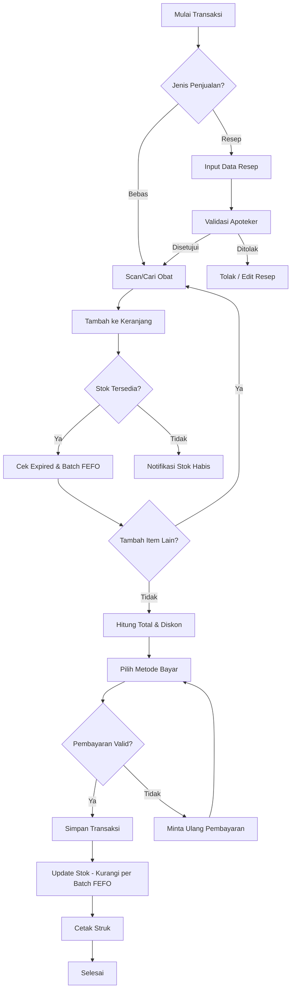

### 4.3 Struktur Data Transaksi

```
Transaksi Penjualan (sales)
├── sale_id (PK)
├── invoice_number (unique, auto-generated)
├── sale_date
├── customer_id (FK, nullable)
├── cashier_id (FK → users)
├── pharmacist_id (FK → users, nullable)
├── prescription_id (FK, nullable)
├── subtotal
├── discount_amount
├── tax_amount
├── grand_total
├── payment_status (paid / partial / unpaid)
├── status (completed / voided / pending)
├── notes
├── shift_id (FK)
├── created_at
└── updated_at

Detail Penjualan (sale_items)
├── sale_item_id (PK)
├── sale_id (FK)
├── product_id (FK)
├── batch_id (FK)
├── unit_id (FK → units)
├── quantity
├── unit_price
├── discount_per_item
├── subtotal
├── is_prescription (boolean)
└── notes

Pembayaran (sale_payments)
├── payment_id (PK)
├── sale_id (FK)
├── payment_method (cash / debit / qris / transfer / credit)
├── amount
├── reference_number
└── payment_date
```

### 4.4 Fitur Tutup Kasir (Shift)

| Data | Keterangan |
|------|-----------|
| Kas Awal | Modal awal kasir saat buka shift |
| Total Penjualan Tunai | Otomatis dari transaksi |
| Total Penjualan Non-Tunai | Debit/QRIS/Transfer |
| Pengeluaran Kas | Pengeluaran operasional selama shift |
| Kas Akhir (Sistem) | Kalkulasi otomatis |
| Kas Akhir (Fisik) | Input manual oleh kasir |
| Selisih | Kas Fisik – Kas Sistem |

---

## 5. Modul Gudang / Warehouse

### 5.1 Fitur Utama

| No | Fitur | Deskripsi |
|----|-------|-----------|
| 1 | **Penerimaan Barang** | Terima barang dari PO, verifikasi qty & batch |
| 2 | **Penempatan Stok** | Assign lokasi rak/shelving |
| 3 | **Kartu Stok Digital** | Riwayat mutasi masuk-keluar per produk |
| 4 | **Lokasi Penyimpanan** | Manajemen rak, lemari, kulkas (suhu khusus) |
| 5 | **Transfer Antar Gudang** | Untuk apotek multi-cabang |
| 6 | **Pemusnahan Obat** | Catat pemusnahan obat expired/rusak |
| 7 | **Monitoring Suhu** | Untuk obat cold-chain |

### 5.2 Alur Penerimaan Barang

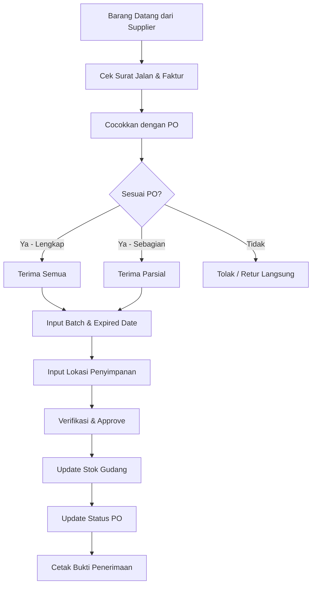

### 5.3 Kartu Stok (Stock Card)

Setiap produk memiliki kartu stok digital yang mencatat:

| Tanggal | Referensi | Keterangan | Batch | Masuk | Keluar | Saldo |
|---------|-----------|------------|-------|:-----:|:------:|:-----:|
| 2026-08-01 | PO-001 | Pembelian dari PT Kimia | B240801 | 100 | - | 100 |
| 2026-08-03 | INV-0012 | Penjualan | B240801 | - | 5 | 95 |
| 2026-08-05 | SO-001 | Stok Opname (selisih) | B240801 | - | 2 | 93 |
| 2026-08-10 | RTP-001 | Retur ke supplier | B240801 | - | 10 | 83 |

### 5.4 Struktur Data Gudang

```
Gudang (warehouses)
├── warehouse_id (PK)
├── name
├── address
├── type (main / branch)
├── is_active
└── created_at

Lokasi Penyimpanan (storage_locations)
├── location_id (PK)
├── warehouse_id (FK)
├── code (misal: RAK-A1-01)
├── name
├── type (rak / kulkas / lemari_narkotika)
├── temperature_range (nullable)
└── is_active

Mutasi Stok (stock_mutations)
├── mutation_id (PK)
├── product_id (FK)
├── batch_id (FK)
├── warehouse_id (FK)
├── mutation_type (in / out / adjustment)
├── reference_type (purchase / sale / return / opname / transfer / destroy)
├── reference_id
├── quantity
├── stock_before
├── stock_after
├── notes
├── created_by (FK → users)
└── created_at
```

---

## 6. Modul Pembelian / Purchasing

### 6.1 Fitur Utama

| No | Fitur | Deskripsi |
|----|-------|-----------|
| 1 | **Purchase Request (PR)** | Permintaan pembelian dari gudang/apoteker |
| 2 | **Purchase Order (PO)** | Order resmi ke supplier |
| 3 | **Approval Workflow** | Persetujuan berjenjang berdasarkan nominal |
| 4 | **Penerimaan Barang** | Verifikasi terhadap PO |
| 5 | **Faktur Pembelian** | Input faktur & jatuh tempo |
| 6 | **Pembayaran Supplier** | Tracking pembayaran (lunas/cicilan) |
| 7 | **Auto-Reorder** | Notifikasi otomatis saat stok mencapai reorder point |
| 8 | **Perbandingan Harga** | Bandingkan harga antar supplier |
| 9 | **Riwayat Pembelian** | History pembelian per produk/supplier |

### 6.2 Alur Pembelian

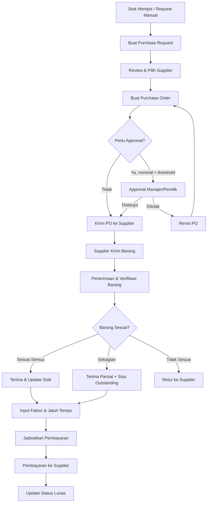

### 6.3 Status Purchase Order

```
Draft → Pending Approval → Approved → Sent to Supplier → 
Partially Received → Fully Received → Invoiced → 
Partially Paid → Fully Paid → Closed
```

### 6.4 Struktur Data Pembelian

```
Purchase Order (purchase_orders)
├── po_id (PK)
├── po_number (unique, auto-generated)
├── supplier_id (FK)
├── warehouse_id (FK)
├── order_date
├── expected_delivery_date
├── status (draft / pending_approval / approved / sent / 
│          partially_received / received / closed / cancelled)
├── subtotal
├── discount_amount
├── tax_amount (PPN)
├── grand_total
├── approved_by (FK → users)
├── approved_at
├── notes
├── created_by (FK → users)
├── created_at
└── updated_at

Detail PO (purchase_order_items)
├── po_item_id (PK)
├── po_id (FK)
├── product_id (FK)
├── unit_id (FK)
├── quantity_ordered
├── quantity_received
├── unit_price
├── discount
├── subtotal
└── notes

Penerimaan Barang (goods_receipts)
├── receipt_id (PK)
├── receipt_number (unique)
├── po_id (FK)
├── supplier_id (FK)
├── receipt_date
├── delivery_note_number (nomor surat jalan)
├── status (draft / verified / approved)
├── received_by (FK → users)
├── verified_by (FK → users)
├── notes
└── created_at

Detail Penerimaan (goods_receipt_items)
├── receipt_item_id (PK)
├── receipt_id (FK)
├── po_item_id (FK)
├── product_id (FK)
├── batch_number
├── expiry_date
├── quantity_received
├── storage_location_id (FK)
├── condition (good / damaged)
└── notes

Faktur Pembelian (purchase_invoices)
├── invoice_id (PK)
├── invoice_number
├── po_id (FK)
├── supplier_id (FK)
├── invoice_date
├── due_date
├── total_amount
├── paid_amount
├── payment_status (unpaid / partial / paid)
├── notes
└── created_at

Pembayaran Supplier (purchase_payments)
├── payment_id (PK)
├── invoice_id (FK)
├── payment_date
├── amount
├── payment_method (transfer / cash / giro)
├── reference_number
├── bank_account
├── notes
└── created_by (FK → users)
```

### 6.5 Fitur Auto-Reorder

Sistem akan otomatis memberi notifikasi ketika:

| Kondisi | Aksi |
|---------|------|
| Stok ≤ **Reorder Point** | ⚠️ Notifikasi "Stok Menipis" |
| Stok ≤ **Safety Stock** | 🔴 Alert "Stok Kritis" |
| Stok = 0 | 🚨 Alert "Stok Habis" + auto-generate Purchase Request |

**Formula:**
```
Reorder Point = (Rata-rata pemakaian harian × Lead time hari) + Safety Stock
Safety Stock   = Rata-rata pemakaian harian × Variasi lead time
```

---

## 7. Modul Retur

### 7.1 Jenis Retur

#### 7.1.1 Retur Pembelian (Return to Supplier)

| No | Fitur | Deskripsi |
|----|-------|-----------|
| 1 | **Retur Barang Rusak** | Barang cacat/rusak saat diterima |
| 2 | **Retur Expired** | Obat mendekati/sudah expired |
| 3 | **Retur Kelebihan** | Qty terima melebihi PO |
| 4 | **Tukar Barang** | Supplier kirim pengganti |
| 5 | **Credit Note** | Potong tagihan berikutnya |
| 6 | **Refund** | Pengembalian uang dari supplier |

#### 7.1.2 Retur Penjualan (Return from Customer)

| No | Fitur | Deskripsi |
|----|-------|-----------|
| 1 | **Retur Salah Obat** | Obat tidak sesuai pesanan |
| 2 | **Retur Kadaluarsa** | Obat yang dibeli ternyata expired |
| 3 | **Retur Rusak** | Kemasan rusak / obat pecah |
| 4 | **Tukar Obat** | Ganti dengan obat lain |
| 5 | **Refund Cash** | Kembalian uang tunai |

### 7.2 Alur Retur Pembelian

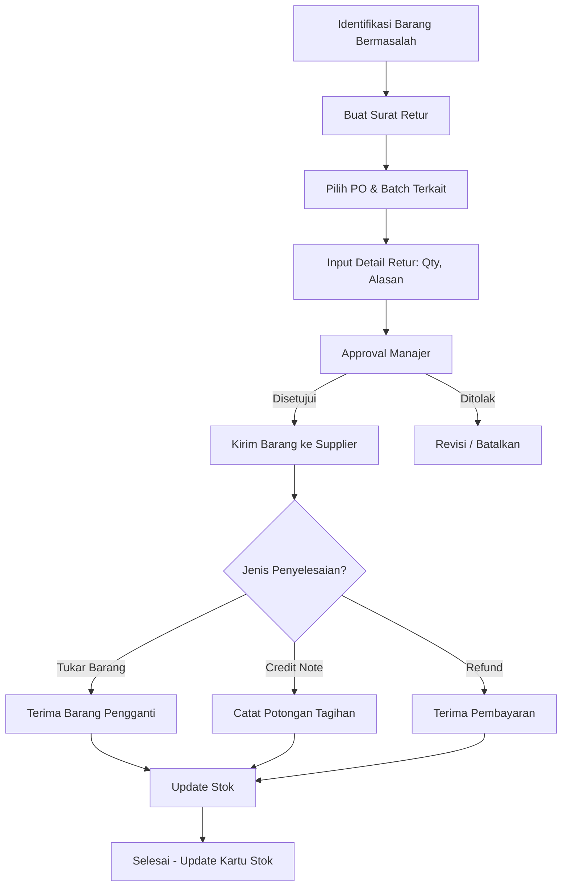

### 7.3 Alur Retur Penjualan

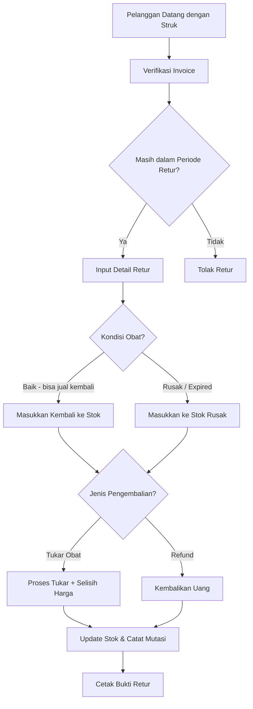

### 7.4 Struktur Data Retur

```
Retur Pembelian (purchase_returns)
├── return_id (PK)
├── return_number (unique)
├── po_id (FK)
├── supplier_id (FK)
├── return_date
├── reason (damaged / expired / excess / wrong_item)
├── status (draft / approved / sent / resolved / cancelled)
├── resolution_type (exchange / credit_note / refund)
├── total_amount
├── notes
├── approved_by (FK → users)
├── created_by (FK → users)
└── created_at

Detail Retur Pembelian (purchase_return_items)
├── return_item_id (PK)
├── return_id (FK)
├── product_id (FK)
├── batch_id (FK)
├── quantity
├── unit_price
├── subtotal
├── reason
└── notes

Retur Penjualan (sale_returns)
├── return_id (PK)
├── return_number (unique)
├── original_sale_id (FK → sales)
├── customer_id (FK, nullable)
├── return_date
├── reason (wrong_item / expired / damaged / other)
├── status (draft / approved / completed / cancelled)
├── resolution_type (exchange / refund)
├── refund_amount
├── refund_method (cash / transfer / debit)
├── processed_by (FK → users)
├── approved_by (FK → users)
├── notes
└── created_at

Detail Retur Penjualan (sale_return_items)
├── return_item_id (PK)
├── return_id (FK)
├── original_sale_item_id (FK)
├── product_id (FK)
├── batch_id (FK)
├── quantity
├── unit_price
├── subtotal
├── item_condition (good / damaged / expired)
├── return_to_stock (boolean)
└── notes
```

---

## 8. Modul Stok Opname

### 8.1 Fitur Utama

| No | Fitur | Deskripsi |
|----|-------|-----------|
| 1 | **Jadwal Opname** | Penjadwalan berkala (harian/mingguan/bulanan/tahunan) |
| 2 | **Opname per Kategori** | Opname partial berdasarkan golongan obat |
| 3 | **Opname per Lokasi** | Opname per rak/area gudang |
| 4 | **Full Opname** | Opname seluruh produk sekaligus |
| 5 | **Input Mobile** | Input via tablet dengan scan barcode |
| 6 | **Selisih Otomatis** | Hitung selisih sistem vs fisik otomatis |
| 7 | **Adjustment** | Penyesuaian stok setelah approval |
| 8 | **Freeze Stok** | Kunci stok sementara selama opname berlangsung |
| 9 | **Laporan Selisih** | Detail selisih per produk & batch |
| 10 | **Audit Trail** | Rekam jejak siapa & kapan melakukan opname |

### 8.2 Alur Stok Opname

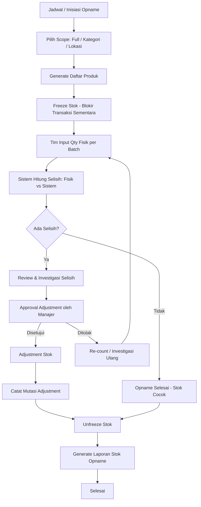

### 8.3 Struktur Data Stok Opname

```
Stok Opname (stock_opnames)
├── opname_id (PK)
├── opname_number (unique)
├── warehouse_id (FK)
├── opname_date
├── scope (full / category / location)
├── scope_filter (category_id / location_id, nullable)
├── status (planned / in_progress / pending_review / 
│          approved / completed / cancelled)
├── total_items
├── matched_items (tidak ada selisih)
├── discrepancy_items (ada selisih)
├── notes
├── initiated_by (FK → users)
├── approved_by (FK → users)
├── approved_at
├── started_at
├── completed_at
└── created_at

Detail Stok Opname (stock_opname_items)
├── opname_item_id (PK)
├── opname_id (FK)
├── product_id (FK)
├── batch_id (FK)
├── location_id (FK)
├── system_qty (stok menurut sistem)
├── physical_qty (stok fisik hasil hitung)
├── discrepancy (physical_qty - system_qty)
├── discrepancy_reason (shrinkage / damage / 
│                       miscounting / theft / other)
├── adjustment_approved (boolean)
├── counted_by (FK → users)
├── counted_at
└── notes
```

### 8.4 Kebijakan Stok Opname

| Tipe | Frekuensi | Scope | Keterangan |
|------|-----------|-------|-----------|
| Harian | Setiap hari | Obat narkotika & psikotropika | Wajib regulasi |
| Mingguan | Setiap minggu | Fast-moving items (top 20%) | Kontrol stok cepat |
| Bulanan | Setiap bulan | Per kategori (rotasi) | Coverage seluruh produk |
| Tahunan | Setiap tahun | Full opname | Tutup buku akhir tahun |

---

## 9. Modul Pengelolaan Stok

### 9.1 Fitur Utama

| No | Fitur | Deskripsi |
|----|-------|-----------|
| 1 | **Real-time Stock** | Stok terkini per produk, batch, dan lokasi |
| 2 | **Multi-Satuan** | Konversi otomatis (1 box = 10 strip = 100 tablet) |
| 3 | **FEFO** | First Expired First Out – otomatis prioritas batch expired terdekat |
| 4 | **Min/Max Stock** | Setting stok minimum & maksimum per produk |
| 5 | **Reorder Point** | Auto-alert saat stok mencapai batas reorder |
| 6 | **Safety Stock** | Buffer stok pengaman |
| 7 | **Dead Stock** | Identifikasi obat yang tidak terjual > 90 hari |
| 8 | **Slow/Fast Moving** | Analisis kecepatan perputaran stok (ABC Analysis) |
| 9 | **Transfer Stok** | Pindah stok antar lokasi/cabang |
| 10 | **Pemusnahan** | Proses pemusnahan obat expired/rusak |
| 11 | **Stok Karantina** | Pisahkan stok yang sedang di-review |

### 9.2 Metode FEFO (First Expired First Out)

Sistem otomatis memilih batch dengan tanggal expired terdekat saat penjualan:

```
Produk: Amoxicillin 500mg
┌────────────┬──────────────┬──────┬──────────┐
│ Batch      │ Expired Date │ Stok │ Prioritas│
├────────────┼──────────────┼──────┼──────────┤
│ B240301    │ 2026-09-30   │  20  │ 1 ⬅️     │
│ B240601    │ 2026-12-31   │  50  │ 2        │
│ B240801    │ 2027-03-31   │  80  │ 3        │
└────────────┴──────────────┴──────┴──────────┘
```

### 9.3 Multi-Satuan & Konversi

```
Produk: Paracetamol 500mg
┌──────────┬────────────┬──────────────┬────────────┐
│ Satuan   │ Konversi   │ Harga Beli   │ Harga Jual │
├──────────┼────────────┼──────────────┼────────────┤
│ Box      │ 1 Box      │ Rp 45.000    │ Rp 55.000  │
│ Strip    │ 10 Strip   │ Rp 4.500     │ Rp 6.000   │
│ Tablet   │ 100 Tablet │ Rp 450       │ Rp 700     │
└──────────┴────────────┴──────────────┴────────────┘

Konversi: 1 Box = 10 Strip = 100 Tablet
```

### 9.4 Analisis ABC (Pareto)

| Kategori | Kriteria | % Produk | % Nilai Penjualan | Frekuensi Opname |
|:--------:|----------|:--------:|:-----------------:|:----------------:|
| **A** | Fast-moving, nilai tinggi | ~20% | ~80% | Mingguan |
| **B** | Medium-moving | ~30% | ~15% | Bulanan |
| **C** | Slow-moving, nilai rendah | ~50% | ~5% | Kuartalan |

### 9.5 Struktur Data Stok

```
Stok (stocks)
├── stock_id (PK)
├── product_id (FK)
├── batch_id (FK)
├── warehouse_id (FK)
├── location_id (FK)
├── quantity
├── reserved_qty (dikunci untuk transaksi pending)
├── available_qty (quantity - reserved_qty)
├── status (available / quarantine / damaged)
└── updated_at

Pengaturan Stok per Produk (stock_settings)
├── setting_id (PK)
├── product_id (FK)
├── warehouse_id (FK)
├── min_stock
├── max_stock
├── reorder_point
├── safety_stock
├── lead_time_days (waktu pengiriman dari supplier)
├── abc_category (A / B / C)
└── updated_at

Transfer Stok (stock_transfers)
├── transfer_id (PK)
├── transfer_number (unique)
├── from_warehouse_id (FK)
├── to_warehouse_id (FK)
├── transfer_date
├── status (draft / approved / in_transit / received / cancelled)
├── notes
├── created_by (FK → users)
├── approved_by (FK → users)
└── created_at

Detail Transfer (stock_transfer_items)
├── transfer_item_id (PK)
├── transfer_id (FK)
├── product_id (FK)
├── batch_id (FK)
├── quantity
├── received_qty
└── notes
```

---

## 10. Modul Data Expired

### 10.1 Fitur Utama

| No | Fitur | Deskripsi |
|----|-------|-----------|
| 1 | **Dashboard Expired** | Ringkasan visual obat yang akan expired |
| 2 | **Alert Bertingkat** | Notifikasi 6 bulan, 3 bulan, 1 bulan, expired |
| 3 | **Daftar Expired** | List produk per range expired date |
| 4 | **Auto-Block** | Blokir otomatis penjualan obat yang sudah expired |
| 5 | **Retur Expired** | Workflow retur ke supplier untuk obat expired |
| 6 | **Pemusnahan** | Proses dan dokumentasi pemusnahan obat |
| 7 | **Laporan Kerugian** | Kalkulasi kerugian akibat expired |
| 8 | **Near-Expired Promo** | Suggest diskon untuk obat mendekati expired |

### 10.2 Tingkat Alert Expired

```
┌─────────────────────────────────────────────────────────────────┐
│                    TIMELINE EXPIRED                             │
│                                                                 │
│  ✅ Normal     ⚠️ Warning    🟡 Caution   🔴 Critical  ⛔ Expired│
│  │             │              │            │            │       │
│  ├─────────────┼──────────────┼────────────┼────────────┤       │
│  > 6 bulan     6 bulan        3 bulan      1 bulan    TODAY    │
│                                                                 │
│  Aksi:         Aksi:          Aksi:        Aksi:       Aksi:   │
│  - Normal      - Notifikasi   - Push sale  - Retur ke  - BLOKIR│
│    sale          ke manajer   - Diskon       supplier     POS  │
│               - Cek opsi       promo      - Rencana  - Musnah-│
│                 retur        - Alert         musnah     kan    │
│                               harian                           │
└─────────────────────────────────────────────────────────────────┘
```

### 10.3 Konfigurasi Alert

| Level | Threshold | Warna | Notifikasi | Auto-Action |
|-------|-----------|:-----:|-----------|-------------|
| **Normal** | > 6 bulan | 🟢 Hijau | Tidak ada | - |
| **Warning** | 3–6 bulan | 🟡 Kuning | Mingguan ke Manajer | - |
| **Caution** | 1–3 bulan | 🟠 Orange | Harian ke Manajer + Gudang | Suggest promo/diskon |
| **Critical** | < 1 bulan | 🔴 Merah | Real-time alert | Generate retur request |
| **Expired** | Sudah lewat | ⛔ Hitam | Immediate | Block dari POS, jadwal pemusnahan |

### 10.4 Alur Penanganan Obat Expired

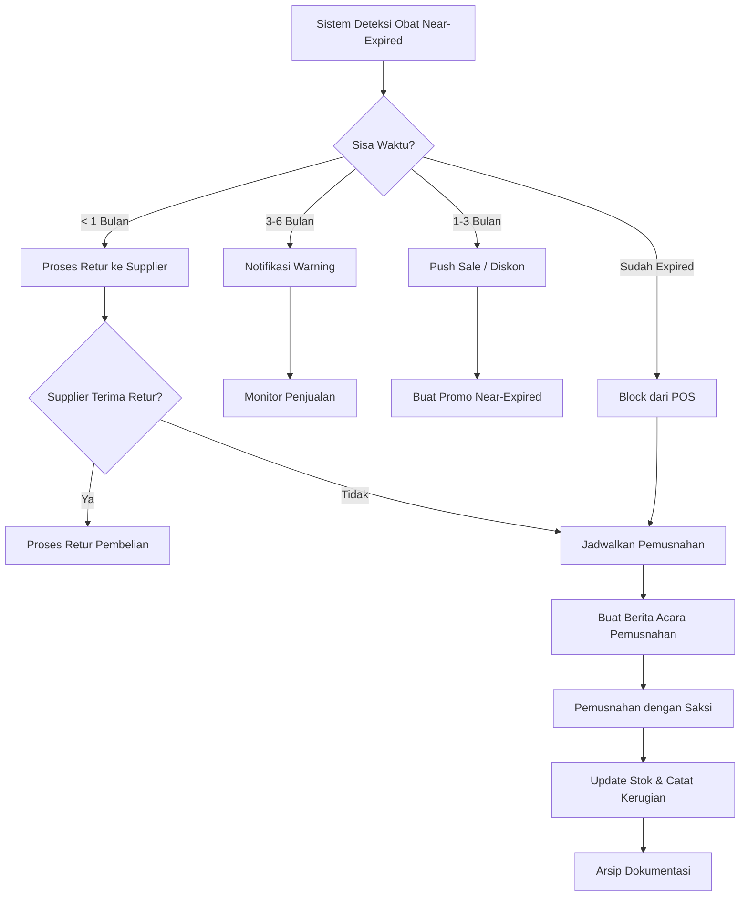

### 10.5 Struktur Data Expired Management

```
Pemusnahan Obat (drug_destructions)
├── destruction_id (PK)
├── destruction_number (unique)
├── destruction_date
├── witness_name (nama saksi)
├── witness_role
├── method (bakar / kubur / kimia / serah_ke_dinas)
├── status (planned / in_progress / completed)
├── total_loss_amount (total nilai kerugian)
├── document_path (upload berita acara)
├── notes
├── executed_by (FK → users)
├── approved_by (FK → users)
└── created_at

Detail Pemusnahan (drug_destruction_items)
├── destruction_item_id (PK)
├── destruction_id (FK)
├── product_id (FK)
├── batch_id (FK)
├── quantity
├── unit_price (harga beli)
├── loss_amount
├── reason (expired / damaged / recalled)
└── notes
```

---

## 11. Modul Batch Management

### 11.1 Fitur Utama

| No | Fitur | Deskripsi |
|----|-------|-----------|
| 1 | **Batch Tracking** | Pelacakan setiap batch dari masuk hingga habis |
| 2 | **Batch Number** | Nomor batch dari pabrik/supplier |
| 3 | **Manufacturing Date** | Tanggal produksi |
| 4 | **Expiry Date** | Tanggal kadaluarsa |
| 5 | **Batch Recall** | Penarikan batch tertentu jika ada masalah |
| 6 | **Batch History** | Riwayat lengkap mutasi per batch |
| 7 | **QR/Barcode per Batch** | Generate label untuk identifikasi |
| 8 | **Multi-Batch per Produk** | Satu produk bisa punya banyak batch aktif |

### 11.2 Lifecycle Batch

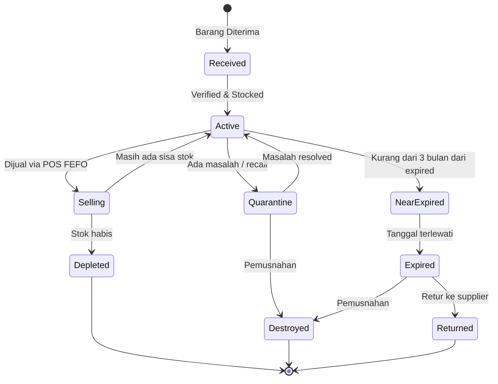

### 11.3 Batch Recall

Ketika ada penarikan batch dari BPOM atau pabrik:

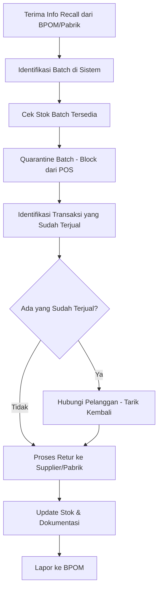

### 11.4 Struktur Data Batch

```
Batch (batches)
├── batch_id (PK)
├── product_id (FK)
├── batch_number (dari pabrik)
├── manufacturing_date
├── expiry_date
├── supplier_id (FK)
├── purchase_price (harga beli per satuan terkecil)
├── received_qty (qty awal diterima)
├── current_qty (qty saat ini)
├── status (active / quarantine / expired / depleted / destroyed)
├── barcode (generated)
├── notes
├── received_date
├── receipt_id (FK → goods_receipts)
└── created_at

Batch Recall (batch_recalls)
├── recall_id (PK)
├── batch_id (FK)
├── recall_number
├── recall_source (bpom / manufacturer / internal)
├── recall_reason
├── recall_date
├── affected_qty
├── sold_qty (qty yang sudah terjual)
├── recovered_qty (qty yang berhasil ditarik)
├── status (initiated / in_progress / completed)
├── action_taken
├── notes
├── created_by (FK → users)
└── created_at
```

---

## 12. Modul Master Data

### 12.1 Data Produk / Obat

```
Produk (products)
├── product_id (PK)
├── product_code (unique, auto/manual)
├── barcode (unique)
├── name
├── generic_name (nama generik)
├── brand (merek)
├── category_id (FK)
├── drug_class (bebas / bebas_terbatas / keras / narkotika / psikotropika / fitofarmaka)
├── form (tablet / kapsul / sirup / salep / injeksi / dll)
├── strength (misal: "500mg", "250mg/5ml")
├── manufacturer_id (FK)
├── requires_prescription (boolean)
├── storage_condition (room_temp / cool / cold_chain)
├── description
├── min_order_qty
├── is_active (boolean)
├── image_url
├── created_at
└── updated_at

Satuan Produk (product_units)
├── product_unit_id (PK)
├── product_id (FK)
├── unit_id (FK → units)
├── conversion_factor (misal: 1 Box = 10)
├── is_base_unit (boolean) → satuan terkecil
├── purchase_price
├── selling_price
├── wholesale_price (harga grosir)
├── prescription_price (harga resep)
└── barcode (barcode khusus satuan ini)
```

### 12.2 Data Supplier

```
Supplier (suppliers)
├── supplier_id (PK)
├── code (unique)
├── name
├── contact_person
├── phone
├── email
├── address
├── city
├── tax_id (NPWP)
├── payment_terms (hari jatuh tempo default)
├── bank_name
├── bank_account_number
├── bank_account_name
├── is_active (boolean)
├── notes
└── created_at
```

### 12.3 Data Pelanggan

```
Pelanggan (customers)
├── customer_id (PK)
├── code (unique)
├── name
├── phone
├── email
├── address
├── date_of_birth
├── gender
├── customer_type (umum / member / instansi)
├── membership_number
├── membership_valid_until
├── discount_percentage (diskon tetap member)
├── credit_limit
├── outstanding_balance
├── allergy_notes (catatan alergi)
├── is_active
└── created_at
```

### 12.4 Data Dokter & Resep

```
Dokter (doctors)
├── doctor_id (PK)
├── name
├── sip_number (Surat Izin Praktik)
├── specialization
├── phone
├── clinic_name
├── clinic_address
└── is_active

Resep (prescriptions)
├── prescription_id (PK)
├── prescription_number
├── doctor_id (FK)
├── customer_id (FK)
├── prescription_date
├── diagnosis
├── status (pending / validated / dispensed / cancelled)
├── validated_by (FK → users, apoteker)
├── validated_at
├── image_url (foto resep)
├── notes
└── created_at

Detail Resep (prescription_items)
├── prescription_item_id (PK)
├── prescription_id (FK)
├── product_id (FK)
├── dosage (misal: "3x1")
├── frequency (misal: "sehari 3 kali")
├── duration_days
├── quantity
├── unit_id (FK)
├── instructions (misal: "sesudah makan")
├── is_compounded (boolean - racikan?)
└── notes
```

### 12.5 Master Data Lainnya

```
Kategori (categories)
├── category_id, name, parent_id, description

Satuan (units)
├── unit_id, name (Box, Strip, Tablet, Botol, Tube, Sachet, dll)

Pabrik (manufacturers)
├── manufacturer_id, name, country, contact

Metode Pembayaran (payment_methods)
├── method_id, name, is_active, fee_percentage
```

---

## 13. Modul Laporan & Dashboard

### 13.1 Dashboard Utama

| Widget | Data | Visual |
|--------|------|--------|
| Total Penjualan Hari Ini | Omzet, jumlah transaksi | Angka + trend |
| Stok Alert | Obat habis, menipis, expired | Counter + badge |
| Top 10 Obat Terlaris | Produk terlaris hari/minggu/bulan | Bar chart |
| Grafik Penjualan | Trend penjualan 30 hari terakhir | Line chart |
| Hutang Supplier | Total hutang & jatuh tempo | Tabel |
| Piutang Pelanggan | Total piutang outstanding | Tabel |
| Near-Expired Alert | Obat yang akan expired ≤ 3 bulan | List + countdown |
| Kas & Keuangan | Ringkasan arus kas hari ini | Summary card |

### 13.2 Daftar Laporan

#### Laporan Penjualan
| No | Laporan | Filter | Format |
|----|---------|--------|--------|
| 1 | Laporan Penjualan Harian | Tanggal, Kasir, Shift | PDF, Excel |
| 2 | Laporan Penjualan per Produk | Periode, Kategori | PDF, Excel |
| 3 | Laporan Penjualan per Pelanggan | Periode, Tipe Customer | PDF, Excel |
| 4 | Laporan Resep | Periode, Dokter | PDF, Excel |
| 5 | Laporan Laba Kotor | Periode | PDF, Excel |
| 6 | Laporan Metode Pembayaran | Periode | PDF, Excel |
| 7 | Laporan Void & Retur | Periode | PDF, Excel |

#### Laporan Stok & Gudang
| No | Laporan | Filter | Format |
|----|---------|--------|--------|
| 1 | Laporan Stok Terkini | Kategori, Gudang | PDF, Excel |
| 2 | Kartu Stok | Produk, Periode | PDF |
| 3 | Laporan Stok Minimum | Gudang | PDF, Excel |
| 4 | Laporan Expired | Range tanggal | PDF, Excel |
| 5 | Laporan Dead Stock | Hari tidak terjual | PDF, Excel |
| 6 | Laporan Stok Opname | Periode, Status | PDF, Excel |
| 7 | Laporan Pemusnahan | Periode | PDF, Excel |
| 8 | Laporan Mutasi Stok | Produk, Periode | PDF, Excel |
| 9 | Analisis ABC | Periode | PDF, Excel |

#### Laporan Pembelian & Keuangan
| No | Laporan | Filter | Format |
|----|---------|--------|--------|
| 1 | Laporan Pembelian | Periode, Supplier | PDF, Excel |
| 2 | Laporan Hutang Supplier | Supplier, Status | PDF, Excel |
| 3 | Aging Hutang | Periode jatuh tempo | PDF, Excel |
| 4 | Laporan Retur Pembelian | Periode, Supplier | PDF, Excel |
| 5 | Laporan Arus Kas | Periode | PDF, Excel |
| 6 | Laporan Laba Rugi | Periode | PDF, Excel |
| 7 | Laporan Piutang Pelanggan | Pelanggan, Status | PDF, Excel |

---

## 14. Modul Resep & Racikan

### 14.1 Fitur Resep

| No | Fitur | Deskripsi |
|----|-------|-----------|
| 1 | **Input Resep** | Input data resep dari dokter |
| 2 | **Foto Resep** | Upload foto resep fisik |
| 3 | **Validasi Apoteker** | Wajib divalidasi sebelum dispensing |
| 4 | **Drug Interaction Check** | Cek interaksi obat (opsional/integrasi) |
| 5 | **Dosis Check** | Validasi dosis sesuai aturan |
| 6 | **Copy Resep** | Salinan resep untuk pembelian ulang |
| 7 | **Riwayat Resep** | History resep per pelanggan |

### 14.2 Fitur Racikan

| No | Fitur | Deskripsi |
|----|-------|-----------|
| 1 | **Template Racikan** | Simpan template racikan yang sering dibuat |
| 2 | **Kalkulasi Bahan** | Hitung otomatis bahan per jumlah racikan |
| 3 | **Harga Racikan** | Otomatis hitung HPP + jasa racik |
| 4 | **Pengurangan Stok** | Kurangi stok per bahan racikan |
| 5 | **Label Obat** | Cetak etiket obat racikan |

### 14.3 Alur Resep & Racikan

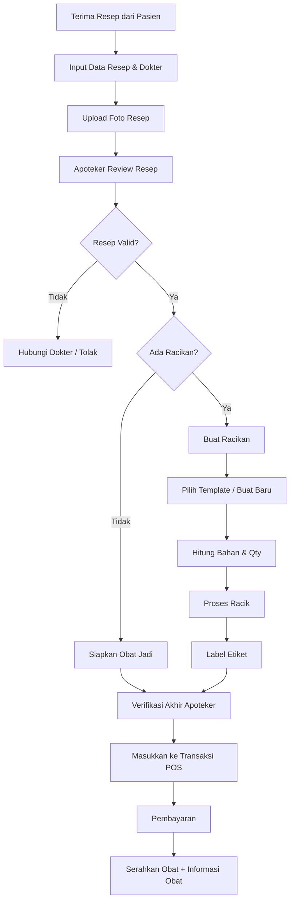

### 14.4 Struktur Data Racikan

```
Template Racikan (compound_templates)
├── template_id (PK)
├── name (misal: "Racikan Batuk Anak")
├── description
├── preparation_instructions
├── service_fee (jasa racik)
├── created_by (FK → users)
└── created_at

Bahan Racikan Template (compound_template_items)
├── template_item_id (PK)
├── template_id (FK)
├── product_id (FK)
├── quantity_per_unit (qty bahan per 1 bungkus racikan)
├── unit_id (FK)
└── notes

Racikan Aktual (compounds)
├── compound_id (PK)
├── prescription_id (FK)
├── template_id (FK, nullable)
├── total_packages (jumlah bungkus)
├── service_fee
├── total_material_cost
├── total_price
├── prepared_by (FK → users)
├── verified_by (FK → users)
└── created_at

Detail Bahan Racikan (compound_items)
├── compound_item_id (PK)
├── compound_id (FK)
├── product_id (FK)
├── batch_id (FK)
├── quantity_used
├── unit_id (FK)
├── unit_price
└── subtotal
```

---

## 15. Desain Database (ERD)

### 15.1 ERD Overview

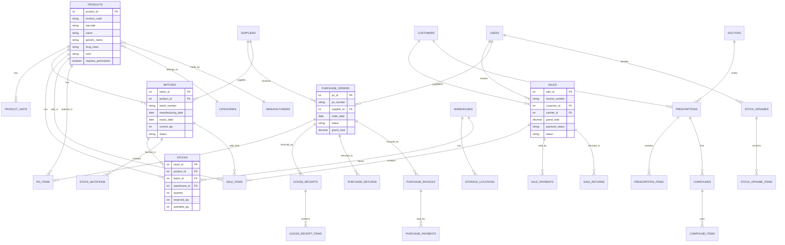

### 15.2 Jumlah Tabel

| Kategori | Tabel | Jumlah |
|----------|-------|:------:|
| Master Data | products, product_units, categories, units, suppliers, customers, doctors, manufacturers, warehouses, storage_locations, users, roles, permissions | 13 |
| Penjualan | sales, sale_items, sale_payments, sale_returns, sale_return_items | 5 |
| Pembelian | purchase_orders, po_items, goods_receipts, goods_receipt_items, purchase_invoices, purchase_payments, purchase_returns, purchase_return_items | 8 |
| Stok | stocks, stock_settings, stock_mutations, stock_transfers, stock_transfer_items | 5 |
| Stok Opname | stock_opnames, stock_opname_items | 2 |
| Batch & Expired | batches, batch_recalls, drug_destructions, drug_destruction_items | 4 |
| Resep & Racikan | prescriptions, prescription_items, compounds, compound_items, compound_templates, compound_template_items | 6 |
| Shift & Kas | shifts, cash_transactions | 2 |
| **Total** | | **45** |

---

## 16. Alur Bisnis Utama (Flowchart)

### 16.1 Alur Bisnis End-to-End

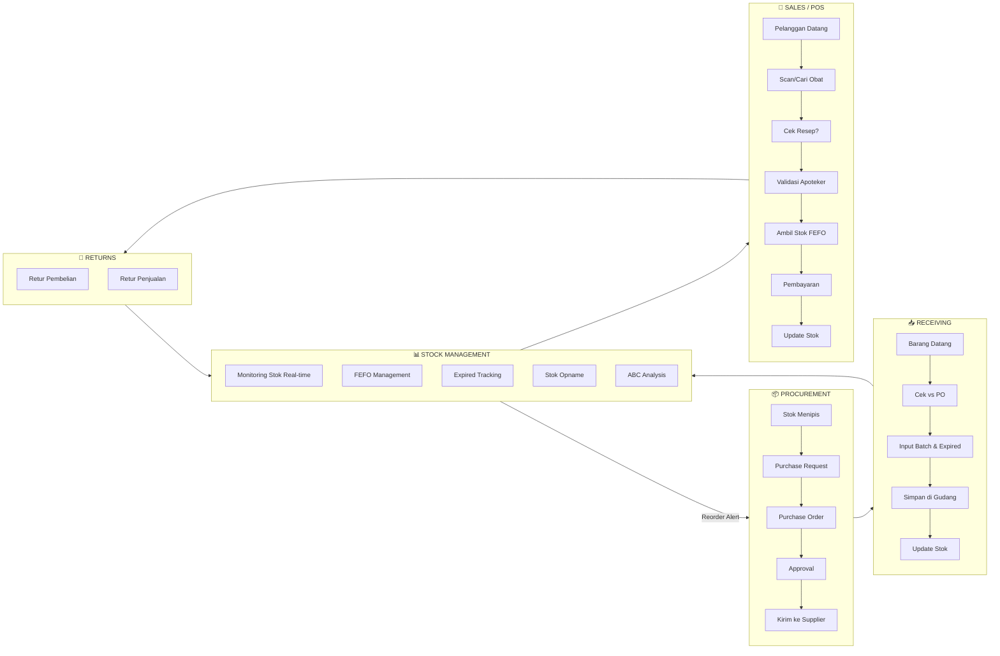

---

## 17. Non-Functional Requirements

### 17.1 Performance

| Metrik | Target |
|--------|--------|
| Response time API | < 200ms (95th percentile) |
| Halaman POS load time | < 1 detik |
| Pencarian produk | < 500ms |
| Generate laporan | < 5 detik |
| Concurrent users | Min 20 user simultan |

### 17.2 Security

| Aspek | Implementasi |
|-------|-------------|
| Autentikasi | JWT + Refresh Token |
| Autorisasi | Role-Based Access Control (RBAC) |
| Password | Bcrypt hashing, min 8 karakter |
| Data Sensitive | Enkripsi at-rest & in-transit (HTTPS/TLS) |
| Audit Trail | Log setiap create/update/delete |
| Session | Auto-expire setelah 15 menit idle |
| Backup | Daily automated backup, 30 hari retention |

### 17.3 Availability & Reliability

| Aspek | Target |
|-------|--------|
| Uptime | 99.5% |
| Backup | Daily automated + weekly full backup |
| Recovery | RTO < 4 jam, RPO < 1 jam |
| Offline Mode | POS tetap bisa transaksi offline (sync saat online) |

### 17.4 Scalability

- Horizontal scaling untuk API server
- Database read replicas untuk laporan
- Redis caching untuk data stok real-time
- Queue system untuk proses berat (laporan, batch processing)

---

## 18. Roadmap Pengembangan

### Phase 1 – Foundation (Bulan 1-2)
| Modul | Fitur |
|-------|-------|
| Master Data | Produk, Kategori, Supplier, Satuan, User |
| Autentikasi | Login, RBAC, Audit Log |
| Stok Dasar | Kartu stok, mutasi masuk/keluar |
| Database | Setup schema, migrasi awal |

### Phase 2 – Core Operations (Bulan 3-4)
| Modul | Fitur |
|-------|-------|
| POS | Transaksi penjualan, pembayaran, cetak struk |
| Pembelian | PO, penerimaan barang, faktur |
| Batch | Tracking batch & expired date |
| Stok | FEFO, multi-satuan, min/max stock |

### Phase 3 – Advanced Features (Bulan 5-6)
| Modul | Fitur |
|-------|-------|
| Retur | Retur pembelian & penjualan |
| Stok Opname | Full & partial opname |
| Expired | Alert system, pemusnahan |
| Resep | Input resep, validasi, racikan |
| Laporan | Laporan penjualan, stok, keuangan |

### Phase 4 – Enhancement (Bulan 7-8)
| Modul | Fitur |
|-------|-------|
| Dashboard | Analytics & visualisasi |
| Multi-Cabang | Transfer stok, consolidation |
| Auto-Reorder | Algoritma reorder point |
| ABC Analysis | Klasifikasi produk otomatis |
| Integrasi | Printer, barcode scanner |

### Phase 5 – Optimization (Bulan 9+)
| Modul | Fitur |
|-------|-------|
| Offline Mode | POS offline capability |
| Mobile App | Stok opname via mobile |
| API Publik | Integrasi pihak ketiga |
| Notifikasi | Push notification, email, WhatsApp |
| Performance | Caching, optimization, load testing |

---

> **Catatan**: Dokumen ini adalah living document yang akan terus diperbarui seiring perkembangan proyek. Setiap perubahan signifikan harus melalui review dan mendapat persetujuan dari stakeholder terkait.

---

*Dokumen dibuat pada: 27 Agustus 2026*  
*Versi: 1.0 – Draft Awal*
